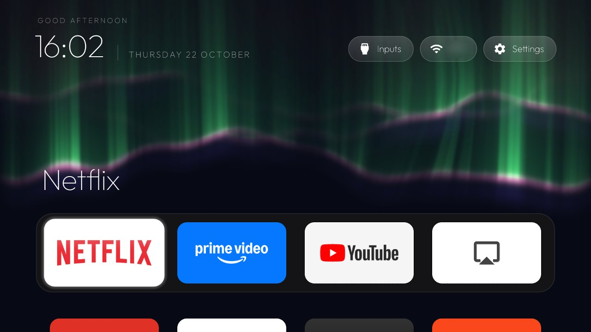

# Aurora: a moving aurora behind Home

This branch of a [cleanyourtv](https://github.com/Gathin23/cleanyourtv) fork adds one launcher option, `aurora`, and
a theme that turns it on, `themes/aurora-live`. Everything else is upstream `main`.



Curtains of light dance along their lower edge, fold and curl, flicker and fade, and slowly change shape. Every
4 to 10 minutes the aurora drifts, at random, to another kind, each placed at the height where that light forms:

| Kind | Source | On screen |
|---|---|---|
| Green | atomic oxygen, the common one | rayed green curtains |
| Red | oxygen high up, during strong activity | a diffuse red glow above the curtains |
| Violet and blue | molecular nitrogen, deep in the atmosphere | a violet band below the lower edge |
| Pink | a bright lower border during substorms | a pink line along the lower edge |
| Yellow | red and green mixed | yellow-green tops on the brightest rays |

## How it works

- `Aurora.java` holds the five kinds, the slow random drift between them, and paints one curtain into a 512x192
  texture with its own folded-triangle noise. Plain Java with JVM unit tests (`AuroraTest`).
- `AuroraMotion.java` bends each texture through a 40x6 grid every frame with `Canvas.drawBitmapMesh`, with a
  brightness per grid point, so the GPU does the bending. Unit tests in `AuroraMotionTest`.
- `AuroraView.java` adds three curtains like light at 20 frames a second and repaints one curtain every 10 seconds
  on a background thread. It runs only while Home is showing (between `onResume` and `onPause`), and stands
  still with `animations` off. With `aurora` off, the view stays gone and nothing runs.

## Cost

Measured on a Philips TPM171E (MediaTek MT5891, 1.9 GB, Android TV 8.0) over 30 s on Home, with a live video
tile also running on Home (most of the baseline):

| | Launcher CPU (all cores) | 90th percentile frame | Memory (PSS) |
|---|---|---|---|
| Without the aurora | 3.9% | 6 ms | about 36 MB |
| With it | about 10% | 8 ms | unchanged |

Nearly all of the extra CPU is Android redrawing Home 20 times a second, not the aurora maths. 25 frames a second
cost 16.7% and made frames late, so it stays at 20. The release APK grows by 5.6 KB, which is why this lives on a
fork rather than in upstream's launcher (its switches stay around 1 KB).

## Try it

Build and install the launcher as upstream describes (`launcher/build-and-install.sh`), then push the theme:

```
TV_HOST=<tv ip> tools/theme.sh themes/aurora-live
```

Or set `<bool name="aurora">true</bool>` in `launcher/app/src/main/res/values/config.xml` (and `ambient_glow`
false). Undo with `tools/theme.sh --reset`.
